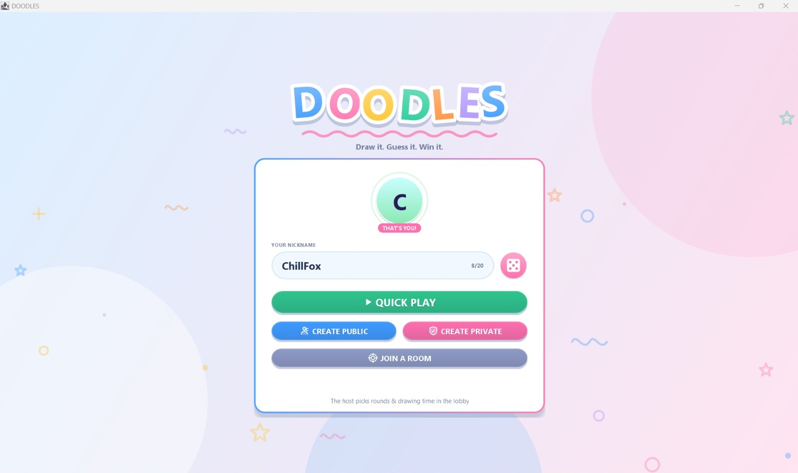
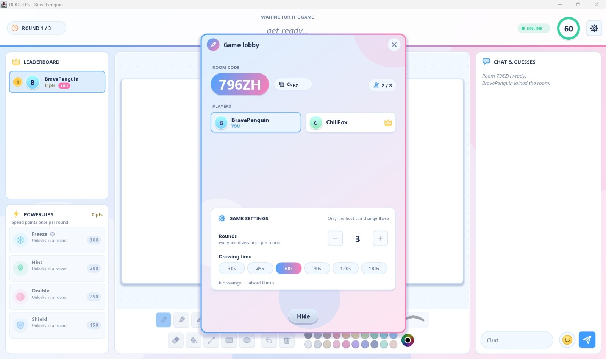
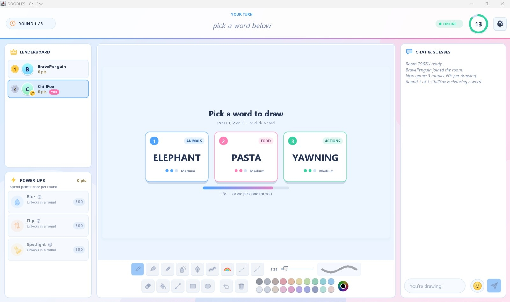
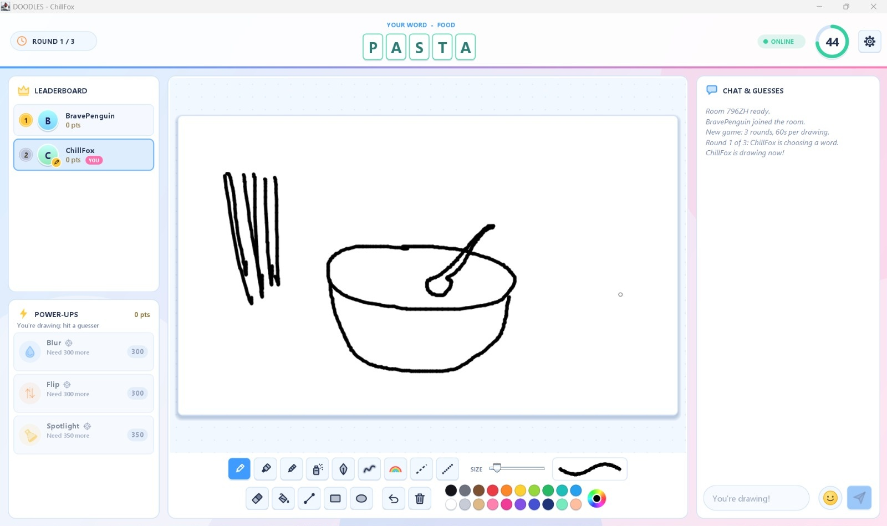
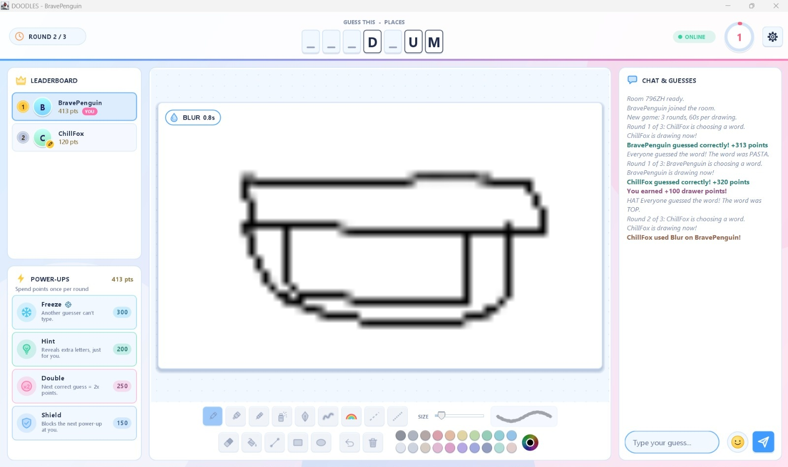
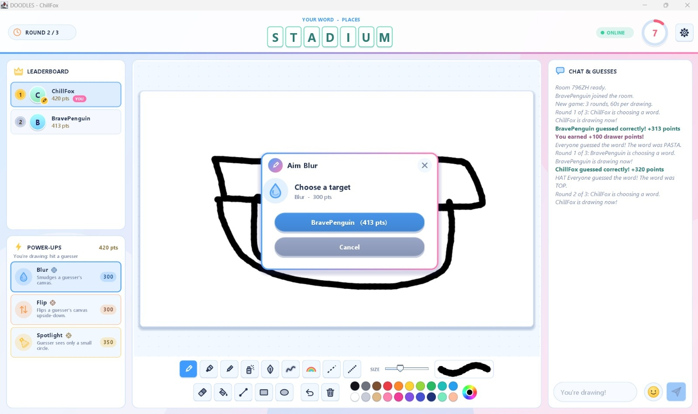
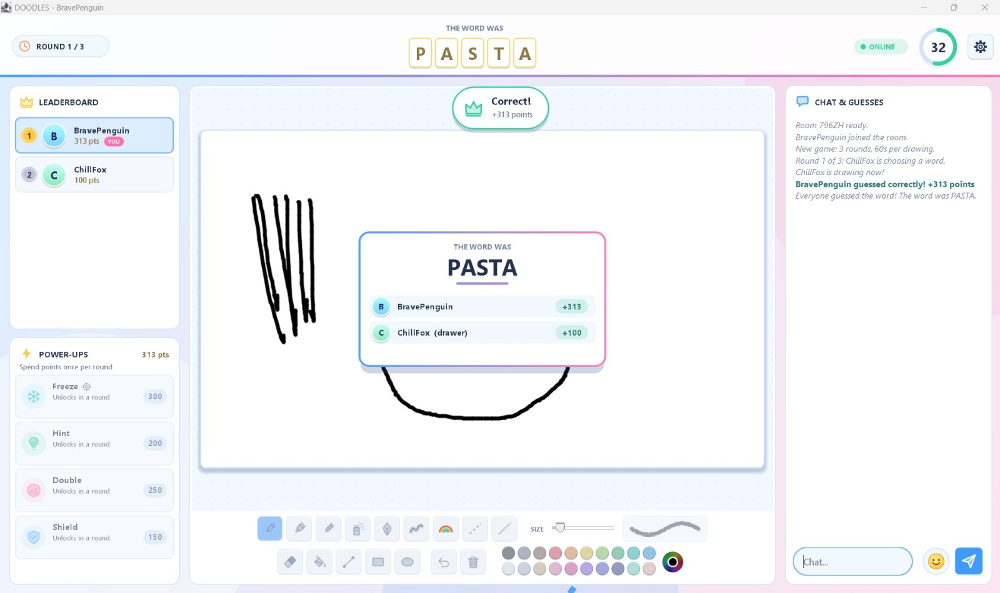

# Doodles

Doodles is a real-time multiplayer drawing and guessing game written in Java (Swing). Players join a
room, take turns drawing a secret word, and the others guess it in the chat. The project contains an
authoritative TCP game server, desktop clients, a MySQL persistence layer and the SQL schema.

## Features

- **Rooms:** quick play, public rooms, private rooms with a 5-character code, lobby with host controls, host transfer if the host leaves
- **Turns:** 2-8 players; the drawer changes after every turn; the host chooses the number of rounds (1-10) and the drawing time (30-180 s)
- **Words:** 700+ words in 17 categories; the drawer picks from 3 choices; progressive hints during the round
- **Scoring:** speed-based points, drawer bonus, a scoreboard for each round plus an overall leaderboard next to the chat, podium at the end
- **Chat:** guesses and chat with 32 emoji, 14 stickers and custom messages
- **Power-ups (unique feature):** players spend points to attack others or help themselves
  - Drawer: Blur, Flip, Spotlight
  - Guesser: Freeze, Hint, Double, Shield
- **Drawing tools:** 9 brushes, eraser, fill, line, rectangle, ellipse, undo, clear, colour picker, save the drawing as PNG
- **Persistence:** players, game sessions, drawings and chat messages are stored in MySQL

## Project modules

| Folder | Purpose |
| --- | --- |
| `src/client` | Game window and screen, drawing canvas, brushes, tool dock |
| `src/server` | TCP server: rooms, rounds, word selection, scoring, power-up validation |
| `src/common` | Shared classes: `Config` (host/port), players, messages, power-ups, emotes |
| `src/ui` | Welcome screen, lobby, room browser, dialogs, leaderboard, power shop, theme, icons |
| `src/database` | JDBC connection and data access objects (players, sessions, drawings, chat) |
| `database` | `doodles_database.sql`, the MySQL schema |
| `lib` | `mysql-connector-j-26.10.0.jar`, the JDBC driver |
| `screenshots` | Project output |

## Requirements

- JDK 21 or newer
- MySQL Server 8.0 or newer, running on `localhost:3306`
- MySQL Connector/J 26.10.0: already included in `lib/` (also declared in `pom.xml` for Maven users)

## Database setup

1. Start MySQL Server.
2. Run the schema script (`database/doodles_database.sql`) with MySQL Workbench or:
   ```sh
   mysql -u root -p < database/doodles_database.sql
   ```
   **Warning:** the script starts with `DROP DATABASE IF EXISTS doodles_db`. It deletes and recreates that database and inserts sample rows, so only run it on a database you can reset.
3. The server connects as MySQL user `root` with password `Doodles@123` by default. If your MySQL account is different, do not edit the source. Set the values instead, using either environment variables or Java options on the **server**:

   | Setting | Environment variable | Java option |
   | --- | --- | --- |
   | URL | `DOODLES_DB_URL` | `-Ddoodles.db.url=...` |
   | User | `DOODLES_DB_USER` | `-Ddoodles.db.user=...` |
   | Password | `DOODLES_DB_PASSWORD` | `-Ddoodles.db.password=...` |

When the server starts it checks the database and prints `Database: READY` (or says exactly what is wrong).
If MySQL is unavailable the game still runs, but nothing is saved.

## How to run

Start the **server first**, then one **client per player**. The default port is `5051`.

### Option A: run scripts (macOS / Linux / Windows)

```sh
./run-server.sh        # or run-server.bat on Windows
./run-client.sh        # or run-client.bat on Windows, once per player
```

The scripts compile the project and use the driver from `lib/`.

### Option B: IntelliJ IDEA

Open the project folder, make sure the jar in `lib/` is a library of the module (right-click `lib` > Add as Library), then run:

1. `server.GameServer`
2. `ui.WelcomeScreen` (run it once per player; allow multiple instances in the run configuration if needed)

### Option C: Maven

```sh
mvn clean compile
mvn dependency:build-classpath -Dmdep.outputFile=target/classpath.txt
java -cp "target/classes:$(cat target/classpath.txt)" server.GameServer
java -cp "target/classes:$(cat target/classpath.txt)" ui.WelcomeScreen
```

(On Windows PowerShell use `;` instead of `:` in the classpath.)

### Playing on two computers

Start the clients with `-Ddoodles.host=<IP address of the server computer>`. To change the port, use
`-Ddoodles.port=NNNN` on the server and on every client.

## Troubleshooting

| Message | Fix |
| --- | --- |
| Could not connect to the Doodles server | Start `GameServer` first |
| No answer from the server | Another program uses that port; change it with `-Ddoodles.port` on server and clients |
| `port 5051 is already in use` | An old server is still running; stop it |
| MySQL driver is not on the classpath | Make sure the jar is in `lib/` and added as a library |
| wrong MySQL user or password | Use the table in "Database setup" step 3 |
| database / table is missing | Run `database/doodles_database.sql` |

## Screenshots

| Welcome screen | Lobby |
| --- | --- |
|  |  |

| Word choice | Active drawing round |
| --- | --- |
|  |  |

| Guessing view (blurred by a power-up) | Power-up targeting |
| --- | --- |
|  |  |

| Round results |
| --- |
|  |
